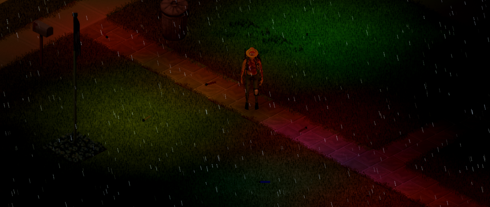

# Fusées de route et bâtons lumineux

## Fusées de route

Clic droit sur une fusée de route de l'inventaire : **Allumer et poser au sol**. Le personnage s'accroupit, l'allume et la pose sur sa case.

- Elle brûle **60 minutes de jeu** (option sandbox) : lumière rouge qui scintille, un peu de fumée rouge, grésillement. Puis elle disparaît.
- **La ramasser coupe sa lumière.** Ramassée, elle n'éclaire plus mais continue de se consumer. Reposée au sol (lâcher, poser ou glisser vers le sol) près d'un joueur, elle brûle de nouveau dans la minute de jeu, pour le temps qui lui reste. Consumée, elle disparaît, au sol comme dans l'inventaire.
- L'option sandbox de nettoyage des objets au sol ne retire pas une fusée qui brûle.

On en trouve dans le matériel d'urgence des stations-service, les outils de garage, les casiers de pompiers et de police, et les coffres des voitures de police (option sandbox).

> Capture à faire : fusée de route allumée sur une route de nuit, avec sa lumière rouge.

## Bâtons lumineux

Quatre couleurs : **vert, rouge, bleu, jaune**. Clic droit sur un bâton neuf : **Activer et poser au sol**.

- Une lueur colorée douce (petit rayon), silencieuse et sans fumée, pendant **8 heures de jeu** (option sandbox). Il ne s'éteint pas.
- Ramassé puis reposé ailleurs, il garde le temps qui lui reste et brille de nouveau dans la minute de jeu, une fois au sol près d'un joueur (lâcher, poser ou glisser vers le sol).
- Échu, il devient un **bâton lumineux usagé**, au sol comme dans les sacs.
- Il n'éclaire qu'une fois posé au sol, pas en main.

On en trouve dans les réserves et surplus de l'armée, les casiers de police et de pompiers, les magasins de camping et le matériel de survie.
