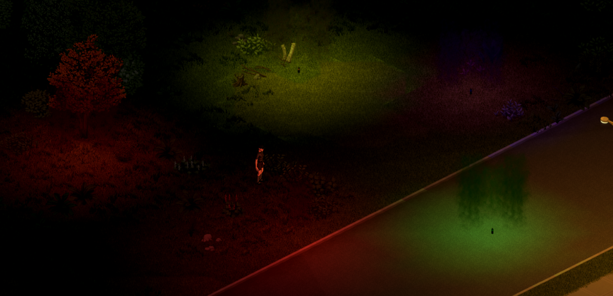

# Signal Smoke

**Signal Smoke** (ID du mod `batman_SignalSmoke`) est un mod Project Zomboid Build 42.21 qui ajoute des grenades fumigènes colorées, des fusées de route, des bâtons lumineux et des bombes fumigènes artisanales, en solo comme en multijoueur. C'est aussi une petite bibliothèque : d'autres mods peuvent poser des fumées, des fusées et des lueurs colorées décidées par le serveur et vues de tous les joueurs.

## Pages

1. [Installation](01-installation.md)
2. [Grenades fumigènes et bombes artisanales](02-fumigenes.md)
3. [Fusées de route et bâtons lumineux](03-fusees-et-batons-lumineux.md)
4. [Options sandbox](04-options-sandbox.md)
5. [Multijoueur](05-multijoueur.md)
6. [API pour les développeurs](06-api-developpeur.md)
7. [FAQ](07-faq.md)

Steam Workshop : [Signal Smoke](https://steamcommunity.com/sharedfiles/filedetails/?id=3811010882) · Code source (MIT) : [GitHub](https://github.com/cyberbobjr/SignalSmoke)
